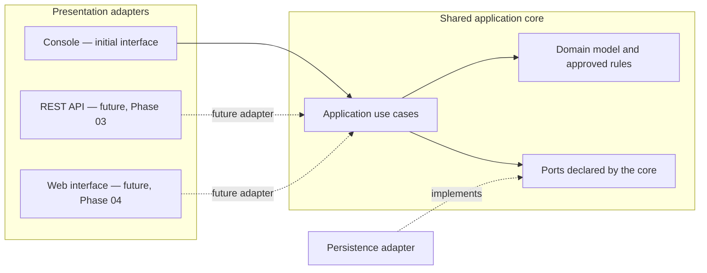

# Architecture Overview — Workflow Step 04

> Status: conceptual documentation. Technology proposals in the linked ADRs
> are pending explicit user approval. This is Workflow Step 04, not project
> Phase 04. Project Phase 02 remains the console application; Phases 03 and 04
> remain the later REST API and web interface.

## Purpose and constraints

This overview translates approved boundaries into a technology-neutral
architecture proposal. It does not authorize application code, select a
database or framework, or resolve business policies.

- The first application interface is the console (FR-020).
- Shared application behavior must remain usable independently of that
  interface (FR-021, R12).
- A later REST API and then web interface are front-ends over the same shared
  behavior (FR-022).
- Keep one simple modular application; do not split it into microservices
  (R12). Do not add AI features (R13).
- Business rules remain in the application core, not in presentation
  adapters. Their values and policies remain those approved in the
  requirements and decision registers.

## Proposed component boundaries

The diagram shows dependency direction, not a selected package layout or
deployment topology. Dashed front-ends are future concepts only.

The core owns use-case coordination, domain behavior, and the interfaces it
needs from external systems. Presentation adapters translate input and output
at those boundaries. A persistence adapter implements a core-owned port; the
core must not depend on a console, database driver, or web framework. These
are proposed dependency boundaries consistent with FR-021–FR-022 and R12;
the exact package/module form remains open under D04.

## Records and business policy

The architecture does not merge catalog records with operational records.
Titles, categories, and physical copies remain catalog concepts; requests,
reservations, loans, return/renewal requests, notifications, fines, and audit
events remain distinct operational concepts as described in the
[domain model](domain-model.md). Use cases and state changes must continue to
respect the approved requirements. Unresolved policies (including D09–D14,
D18–D20, D23–D25, D30–D40) remain unresolved; no adapter or persistence
choice settles them.

## Technology proposals and approval boundary

The proposals below are options for review, not adopted decisions. D01–D06
remain Open in [the decision register](../open-decisions.md); D37 also remains
Open. No dependency, source code, build file, database schema, or deployment
configuration is added by this workflow step.

| ADR | Proposal area | Existing open decisions | Status |
|---|---|---|---|
| [ADR-0001](../decisions/ADR-0001-language-and-build.md) | Java target, build wrapper, test framework | D01, D02, D05 | Proposed — pending explicit approval |
| [ADR-0002](../decisions/ADR-0002-database-and-persistence.md) | Relational database, JDBC/ORM, migrations | D03 (and D01/D02 compatibility) | Proposed — pending explicit approval |
| [ADR-0003](../decisions/ADR-0003-application-architecture.md) | Simple modular core, boundaries, logging | D04 (and D01/D02 compatibility) | Proposed — pending explicit approval |
| [ADR-0004](../decisions/ADR-0004-future-web-architecture.md) | Later REST framework, security approach, web client | D06, D37 (and D01 compatibility) | Conceptual proposal — pending explicit approval |

Approval of one ADR does not approve another or resolve any business-policy
decision. Review compatibility again when an ADR is approved and immediately
before implementation, because release support changes over time.
