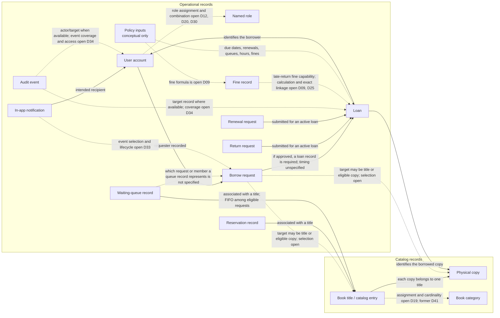

# Domain Model — Workflow Step 03

> This is a requirements-derived conceptual model for workflow Step 03. It
> does not authorize application code or choose unresolved policies. Project
> Phase 02 remains the console application.

## Modeling conventions

- Solid arrows show relationships or capabilities stated in approved project
  requirements or explicitly requested for the requirements baseline.
- Dashed arrows show a possible association whose presence, cardinality, or
  behavior depends on an open decision. They are not implementation rules.
- A policy node is a conceptual reference to unresolved policy inputs, not a
  claim that the application stores a `LibraryPolicy` entity.
- The model distinguishes catalog records (descriptions of holdings) from
  operational records (requests, loans, notifications, and audit events).

## Conceptual relationship diagram

## Confirmed relationships and scope

| Relationship | Basis and limit |
|---|---|
| A physical copy belongs to a catalog title. | FR-002–FR-003; BR-001. The number of copies per title is not otherwise constrained. |
| A borrow request records its requester and target. | FR-007. The target may be a title or an eligible copy; the applicable choice and eligibility rules are not fixed. |
| An approved borrow request requires a recorded loan and due date. | FR-014. This does not specify when the loan is created, whether a reservation or queue allocation intervenes, or the copy-assignment timing. |
| A loan identifies the borrowed copy and borrower. | Project glossary and the approved circulation scope. Limits on concurrent loans remain open (D14). |
| Return and renewal requests are submitted for an active loan. | FR-011 and FR-013. Their decision authority and outcome policies remain unresolved. |
| Reservation and waiting-queue records are associated with a title. | FR-010. Enrollment, allocation, expiry, and the relation between a queue entry and a borrow request remain open (D11; merged historical IDs D21, D22, D39). |
| A notification has an intended user. | FR-017. Which events produce notifications and their read/retention behavior remain open (D33). |
| Audit records represent significant actions. | FR-018 and success criterion SC7. Exact event coverage, actor/target availability, access, and retention remain open (D34). |
| A fine may be recorded for a late return. | FR-015 and BR-006. Amount, calculation, effective return date, and exact record cardinality remain open (D09, D25; merged historical D29). |

## Relationships that remain conditional or undefined

- **User and role:** the four role names are approved, but grants, guest
  privileges, and whether staff may also be members are open (D12, D20, D30).
  The diagram does not imply that every account has exactly one role.
- **Title and category:** category management is requested, but taxonomy,
  hierarchy, and title association cardinality are open (D19; merged historical
  D41).
- **Borrow request and reservation:** no requirement says that every borrow
  request creates a reservation. Whether an unavailable title creates a
  waiting entry, and how a request relates to a queue entry, remain open (D11).
- **Approved request and loan:** FR-014 requires a loan record for an approved
  request, but does not say that creation is immediate or specify copy
  allocation timing.
- **Policy representation:** loan periods, due-date calculation, renewal
  eligibility, queue behavior, fines, and automatic schedule enforcement are
  policies/inputs, but no persisted policy entity or configuration structure is
  approved (D09–D13, D18, D26–D29 merged under their parents).
- **Notifications and audit events:** the recipient/capability is supported;
  exact event-to-record associations and access rules remain open (D30,
  D33–D34).

No one-to-one or one-to-many cardinality is asserted unless the approved text
states it. In particular, reservation counts, concurrent loans, request
resubmission, and repeated return/renewal requests are not inferred.

## Traceability

The model is based on [FR-001–FR-022](../requirements/functional-requirements.md),
[NFR-001–NFR-007, NFR-010, NFR-012](../requirements/non-functional-requirements.md), and
[BR-001–BR-009](../requirements/business-rules.md), with the constraints in
[`AGENTS.md`](../../AGENTS.md), the project charter and scope, and the
[decision register](../open-decisions.md). D21, D22, D26–D29, D35, D39, and
D41 are historical IDs merged into their parent decisions; references to them
do not make them separate active policies.
