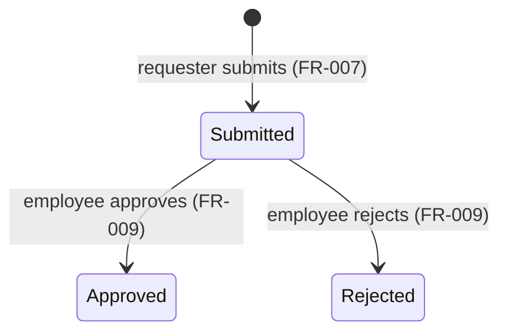
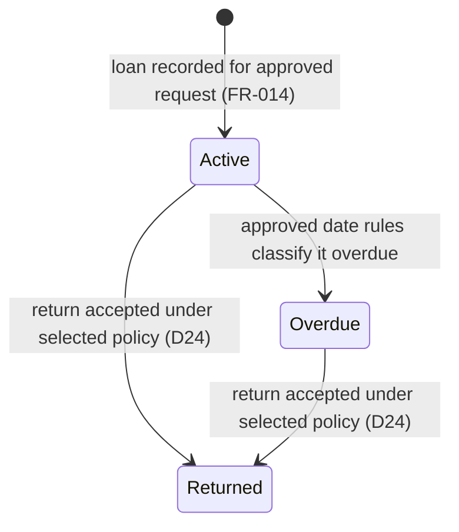
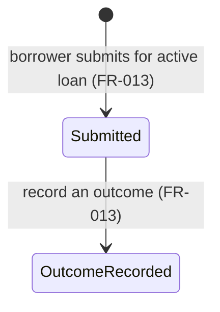

# Request and Loan State Machines — Workflow Step 03

> These diagrams show only transitions established by the requirements or
> clearly marked alternatives. An omitted transition may be undefined rather
> than invalid. No policy recommendation here is approved.

## Borrow request

FR-009 requires an employee to approve or reject a borrow request and record
the decision and time. The pending state and two possible recorded outcomes
are therefore shown. D23 leaves pending expiry, withdrawal, escalation, and
resubmission unresolved.

The diagram does not assert that `Approved` or `Rejected` is irrevocably
terminal, nor that the same request can be resubmitted. Those lifecycle details
are not specified (D23). An approved request requires a loan record under
FR-014, but the time and copy-allocation sequence are not specified.

## Loan

The due date and loan record are required for an approved borrow request
(FR-014). “Overdue” is a condition determined by approved due-date and
return-date rules, not a selected calendar formula (FR-015; D13, D25).

The initial arrow identifies the first modeled loan condition; it does **not**
assert immediate loan creation at borrow approval. A submitted return request
does not itself establish that the loan has been returned. Whether a return is
reviewed, automatically accepted, or reviewed only in exceptions is open
(D24); the effective return date is also open (D25). Renewal may affect a due
date, but eligibility, authority, limits, and the exact state effect remain
open (D10, D13, D14, D30).

## Return request

FR-011 supports submission for an active loan; FR-012 allows an authorized
employee to review a return request and record an outcome. Whether every return
requires review or only exceptions do remains open under D24. The generic
outcome node avoids inventing approved/rejected labels.

```mermaid
stateDiagram-v2
    [*] --> Submitted : borrower submits for active loan (FR-011)
    Submitted --> OutcomeRecorded : employee records outcome (FR-012; D24)
    Submitted --> AutoAccepted : only if selected under D24
```

`AutoAccepted` is a conditional alternative, not an approved transition.
Effective date may be submission, approval, or a separately entered receipt
time (D25). The return-request outcome and the loan's effective returned state
must not be treated as the same timestamp by assumption.

## Renewal request

FR-013 establishes submission for an active loan and recording an outcome, but
does not define the outcome vocabulary or whether the decision is automatic or
employee-reviewed. D10, D14, D23, and D30 remain relevant.

The diagram does not assert that approval necessarily extends the due date,
how far it extends it, or whether a request can remain pending, expire, or be
withdrawn. Those choices require decisions (D10, D13, D23).

## Reservation and waiting-queue lifecycle

The requirements support title-associated reservation and waiting-queue
records and FIFO ordering for already-eligible requests (FR-010, BR-003).
They do not establish a complete set of lifecycle states, so a state diagram
would falsely make choices about enrollment, offers, fulfillment, or expiry.
These remain open under D11 (including merged historical D21, D22, and D39).
Equal timestamps remain open under D40.

## Confirmed invalid transitions and undefined transitions

These transitions are derived from the
[functional requirements](../requirements/functional-requirements.md),
[business rules](../requirements/business-rules.md), and
[open-decision register](../open-decisions.md).

| Classification | Transition or behavior | Basis |
|---|---|---|
| Confirmed invalid | Create a loan from a rejected borrow request. | FR-014 requires a loan record for an approved borrow request; a rejected request is not approved. |
| Confirmed invalid | Submit a return or renewal request against a loan that is not active. | FR-011 and FR-013 specify an active loan as the submission precondition. |
| Undefined, not declared invalid | Expire, withdraw, escalate, reopen, or resubmit an unprocessed/decided borrow request. | Pending and rejected request handling is open (D23). |
| Undefined, not declared invalid | Automatically create a reservation for a borrow request; enroll on opt-in; allocate/skip a queue entry; activate or expire a hold. | Queue and reservation policy is open (D11; merged historical D21/D22/D39). |
| Undefined, not declared invalid | Choose employee review for every return, exception-only review, or automatic acceptance; choose the effective return date. | D24 and D25. |
| Undefined, not declared invalid | Approve/deny renewal under a particular eligibility rule, extend a due date, or resolve a pending renewal. | D10, D13, D14, D23, D30. |
| Undefined, not declared invalid | Classify a loan as overdue using a specific duration, calendar, holiday, or enforcement rule. | D13, D18, D25; D18 concerns automatic enforcement, not the approved operational practice. |

Only the first two rows are asserted as invalid based on explicit requirements.
Other absent transitions are left undefined until the related policy is
approved; they must not be treated as prohibited or permitted by this model.
