# Proposed Entity-Relationship Model

**Status:** Workflow Step 05 proposal; not an approved persistence schema or DBMS selection. The conceptual model follows the approved requirements and Workflow Step 03 documents. A line in the diagram means a confirmed relationship only. Missing edges and cardinalities are intentional where the requirements or an open decision do not establish them.

## Catalog and operational records

```mermaid
erDiagram
    BOOK_TITLE ||--o{ PHYSICAL_COPY : "each copy belongs to one title"
    USER_ACCOUNT ||--o{ BORROW_REQUEST : "requester recorded"
    USER_ACCOUNT ||--o{ LOAN : "borrower recorded"
    PHYSICAL_COPY ||--o{ LOAN : "copy identified by loan"

    BOOK_TITLE {
        identifier title_id PK
    }
    PHYSICAL_COPY {
        identifier copy_id PK
        identifier title_id FK
    }
    CATEGORY {
        identifier category_id PK
    }
    USER_ACCOUNT {
        identifier account_id PK
    }
    ROLE {
        identifier role_id PK
    }
    USER_ROLE {
        identifier account_id FK
        identifier role_id FK
    }
    BORROW_REQUEST {
        identifier request_id PK
        identifier requester_account_id FK
        timestamp submitted_at
        identifier promotion_reservation_id FK
    }
    WAITING_QUEUE {
        identifier queue_id PK
        identifier title_id FK
    }
    QUEUE_ENTRY {
        identifier entry_id PK
        identifier queue_id FK
        identifier borrow_request_id FK
        identifier promotion_reservation_id FK
    }
    RESERVATION {
        identifier reservation_id PK
        identifier title_id FK
        identifier queue_entry_id FK
    }
    COPY_CLAIM {
        identifier copy_id PK
        text claim_kind
        identifier reservation_id FK
        identifier loan_id FK
    }
    LOAN {
        identifier loan_id PK
        identifier borrow_request_id FK
        identifier copy_id FK
        identifier borrower_account_id FK
        date due_date
    }
    RETURN_REQUEST {
        identifier return_request_id PK
        identifier loan_id FK
        timestamp submitted_at
    }
    RENEWAL_REQUEST {
        identifier renewal_request_id PK
        identifier loan_id FK
        timestamp submitted_at
    }
    FINE {
        identifier fine_id PK
    }
    NOTIFICATION {
        identifier notification_id PK
        identifier recipient_account_id FK
    }
    AUDIT_EVENT {
        identifier event_id PK
        timestamp occurred_at
        text target_type
        identifier target_id
    }
    POLICY_REVISION {
        identifier policy_revision_id PK
        text policy_key
        timestamp effective_from
        timestamp effective_until
    }
```

The confirmed relations shown are: each copy belongs to one book title (FR-002, FR-003); each borrow request records one requester (FR-007); and each loan identifies one borrower and one physical copy (approved domain model). The copy-to-loan relation shows zero or more historical loans per copy; it does not determine a concurrent-loan limit (D14). The title-to-copy cardinality shows zero or more copies per title; it does not assert that every title must already have a copy. FK attributes shown in entity boxes are candidate schema references and may be conditional; they are not confirmed domain edges without a relationship line. The diagram deliberately does not encode category cardinality (D19; D41 is merged into D19), account-role cardinality or grants (D12, D30), request target and reservation relationships (D11; D21, D22, and D39 are merged into D11), queue eligibility or order ties (D11, D40), or policy persistence (D03 and the policy boundary described in the approved domain model).

The operational table names and confirmed data facts are not a claim that every borrow request creates a reservation, that every approved request immediately creates a loan, or that a request has one universal lifecycle. FR-014 requires a loan and due date for an approved borrow request, while timing/allocation details remain open; it does not require every loan to have a borrow request. The association and timing are described as a requirement-level dependency, not a cardinality edge here. `LOAN.borrow_request_id` is optional in the proposed relational schema, and the fine-to-loan association remains conditional.

## Relationships intentionally left conditional

| Candidate association | Confirmed part | Unresolved part / reference |
|---|---|---|
| Title–category | Categories classify catalog titles (FR-001). | One/many categories per title and category hierarchy/taxonomy are open (D19; D41 merged into D19). |
| Account–role | Role names include manager, employee, student, and guest (FR-004). | Whether assignment is single or multiple, and action grants, remain open (D12, D30). |
| Request–target | A borrow request records its requester, target, and submission time (FR-007). | Target representation is unsettled in the approved requirements; no separate decision ID is assigned to this schema choice. |
| Request–loan | An approved borrow request must have a loan and due date (FR-014). | Exact conversion timing, multiplicity, and copy allocation are not fixed. |
| Request–queue/reservation | Waiting queues and reservations are title-associated capabilities (FR-010). | Entry conditions, membership, request linkage, allocation, expiry, and tie handling remain open (D11, D23, D40; D39 merged into D11). |
| Copy–reservation/loan claim | A copy must not be committed as allocated to conflicting active claims; this document proposes an integrity mechanism. | Claim lifecycle depends on policy-defined eligibility and event outcomes. Proposed design is not an approved domain rule. |
| Loan–return/renewal request | Requests concern an active loan (FR-011, FR-013). | Review, acceptance, effective return time, renewal eligibility, and effects remain open (D10, D24, D25; D27 merged into D10). |
| Loan–fine | A fine may be recorded for an overdue loan (FR-015). | Whether/how a fine links to a loan, calculation, currency, effective date, and cardinality remain open (D09, D25; D29 merged into D09). |
| Account–notification | Notifications have a recipient (FR-017). | Events, delivery/read lifecycle, and links to source records remain open (D33). |
| Audit event–actor/target | Significant actions record actor/action/target/time where available (FR-018). | Coverage, access, retention, and precise references remain open (D34). |
| Policy–operation | Configurable library policies are in scope for design evaluation. | A persistent policy entity and storage representation are not approved; D03 and policy-specific decisions constrain this proposal. |

`COPY_CLAIM` is a proposed technical coordination record, not a new reservation or loan domain concept. Its primary key permits at most one current claim per physical copy. For loan claims, the proposed composite FK matches claim copy to loan copy; for reservation claims, title-to-copy equality is a transaction-protocol check. The optional queue-entry promotion marker and reservation provenance FK are concurrency/schema candidates only; they do not resolve queue membership, lifecycle, or cardinality. The diagram intentionally does not draw these FKs as confirmed domain relationships. See [schema design](schema-design.md), [constraints and indexes](constraints-and-indexes.md), and [transaction design](transaction-design.md) for integrity limits and conditional lifecycle behavior.
